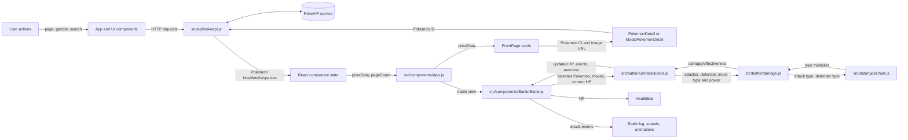
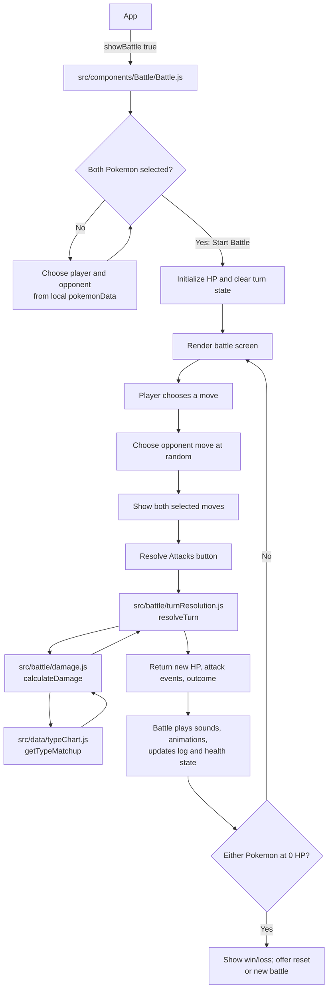

# `src/` code and data flow

This is a reading map of the current source code. The diagrams show both which components call each other and how data/state moves between them. Some exported components are currently placeholders and are not used by the active battle screen.

## Data flow at a glance



**Reading the arrows:** solid flows toward the API are requests; flows back from the API are returned data. Battle calculations flow from the UI into pure calculation modules and return results to update the UI.

## Function-level flow

This chart names the main functions and callbacks that pass control or data through the app. React setters represent state updates that trigger rendering.

```mermaid
flowchart TD
    Mount[React mounts] --> RenderApp[App()]
    RenderApp --> Effect[useEffect on page change]
    Effect --> GetPage[getPokeImageUrl(offset, limit)]
    GetPage --> AxiosList[pokeapi.get(/pokemon?offset&limit)]
    AxiosList -->|results URLs| AxiosDetails[pokeapi.get for each Pokemon URL]
    AxiosDetails -->|Pokemon detail objects| SetPokemon[setPokeData(pokemonData)]
    AxiosList -->|count| SetCount[setResponseCount(count)]
    SetPokemon --> RenderCards[FrontPage({ pokeData, setOpenModal })]
    RenderCards -->|map each Pokemon| CardClick[Link onClick: setOpenModal(true)]
    CardClick -->|route /PokemonDetail/:id| DetailComponent[PokemonDetail()]
    CardClick -->|route /ModalPokemonDetail/:id| ModalComponent[ModalPokemonDetail()]
    DetailComponent --> DetailEffect[useEffect: getDetail()]
    DetailComponent --> SpeciesEffect[useEffect: getDescription()]
    ModalComponent --> ModalEffects[useEffect: getDetail() and getDescription()]
    DetailEffect -->|pokeapi.get pokemon/id| DetailData[setDetail(data)]
    SpeciesEffect -->|pokeapi.get pokemon-species/id| SpeciesData[setDescription(data)]
    ModalEffects -->|API responses| ModalState[setDetail / setDescription]

    SearchForm[SearchBar form submit] --> OnForm[onFormSubmit(event)]
    OnForm --> OnSearch[onSearchSubmit(term)]
    OnSearch --> SearchRequest[pokeapi.get(/pokemon/term)]
    SearchRequest -->|response.data.id| Navigate[navigate(/PokemonDetail/id)]

    FilterSelect[PokeSelect onChange] --> Change[change(option)]
    Change --> SelectHandler[onSelectChange(option)]
    SelectHandler --> GenderRequest[pokeapi.get(/gender/option)]
    GenderRequest --> Names[map species names; paginate(array, 0, 6)]
    Names --> PokemonRequests[pokeapi.get(/pokemon/name) for each]
    PokemonRequests -->|Pokemon detail objects| SetFiltered[props.setPokeData(pokemonData)]

    BattleButton[App Start Battle onClick] --> SetBattle[setShowBattle(true)]
    SetBattle --> BattleRender[Battle()]
    BattleRender -->|selection button onClick| SetSelection[setSelectedPlayer / setSelectedOpponent]
    SetSelection --> Start[handleStartBattle()]
    Start -->|initialize HP and turn state| BattleScreen[Render battle screen]
    BattleScreen -->|move button onClick| SelectMove[handleSelectMove(playerMoveIndex)]
    SelectMove -->|random opponent move; update selected moves| Pending[setWaitingForResolve(true)]
    Pending -->|Resolve Attacks onClick| Resolve[handleResolveAttacks()]
    Resolve --> Turn[resolveTurn(state, moves)]
    Turn --> CalcPlayer[calculateDamage(player, opponent, moveType, power)]
    Turn --> CalcOpponent[calculateDamage(opponent, player, moveType, power)]
    CalcPlayer --> Matchup[getTypeMatchup(attackType, defendType)]
    CalcOpponent --> Matchup
    Matchup -->|type multiplier| CalcPlayer
    Matchup -->|type multiplier| CalcOpponent
    CalcPlayer -->|damage result| Turn
    CalcOpponent -->|damage result| Turn
    Turn -->|new HP, events, outcome| Resolve
    Resolve -->|set HP/log/last damage| BattleState[React state updates and rerender]
    Resolve -->|event effects| Audio[playSoundForDamage / playEndSound]
    Resolve -->|target animation| Animation[triggerAnimation(ref, class)]
    Animation --> Floating[createFloatingDamage(x, y, damage)]
    BattleState --> HealthBar[HealthBar({ pokemon, maxHP, currentHP })]

    PageControl[Pagination onChange] --> SetPage[setPage(page)]
    SetPage --> Effect
```

### Key function responsibilities

- **`App`** — owns listing/page/battle state; `getPokeImageUrl` fetches a page, and `renderFrontPage` chooses loader or listing content.
- **`FrontPage`** — maps Pokémon data into cards and builds detail-route links.
- **`onSearchSubmit`** — looks up a Pokémon by name, then navigates using its returned ID.
- **`onSelectChange`** — fetches gender-associated Pokémon and passes the selected results to App state.
- **`handleStartBattle` / `handleSelectMove` / `handleResolveAttacks`** — initialize battle state, choose both moves, and apply one turn.
- **`resolveTurn` / `calculateDamage` / `getTypeMatchup`** — calculate turn events, damage, and type effectiveness without rendering UI.

## App startup and Pokédex

```mermaid
flowchart TD
    Browser[Browser loads app] --> Entry[src/index.js]
    Entry --> Router[BrowserRouter + Routes]
    Router --> App[src/components/App.js]
    App --> Init[useEffect: fetch first page]
    Init --> Api[src/api/pokeapi.js\nAxios client]
    Api --> PokeAPI[(PokeAPI)]
    PokeAPI --> AppData[App stores Pokemon data\nand total result count]
    AppData --> Grid[App renders page layout]
    Grid --> Search[SearchBar]
    Grid --> Filter[PokeSelect gender filter]
    Grid --> Outlet[Route Outlet: selected view]
    Grid --> Listing[FrontPage: Pokemon cards]
    AppData --> Listing
    Listing --> Avatar[AvatarImage]
    Avatar --> Image[ImageCard]
    Image --> Listing
    Listing -->|click card| DetailChoice{Viewport width?}
    DetailChoice -->|at least 576px| DetailRoute[/PokemonDetail/:index]
    DetailChoice -->|under 576px| ModalRoute[/ModalPokemonDetail/:index]
    DetailRoute --> Detail[PokemonDetail]
    ModalRoute --> Modal[ModalPokemonDetail]
    Detail --> Api
    Detail --> Species[Fetch pokemon-species description]
    Species --> Api
    Modal --> Api
    Search -->|submit name| Api
    Api -->|Pokemon id| Search
    Search --> DetailRoute
    Listing -->|pagination| Init
    Filter -->|gender selection| Api
    Api -->|filtered Pokemon| AppData
    Grid -->|Start Battle| BattleView[Battle view]
    BattleView --> Battle[src/components/Battle/Battle.js]
```

### Pokédex path, in words

1. `src/index.js` mounts the React app and declares routes inside `BrowserRouter`.
2. `App` in `src/components/App.js` owns the current page, fetched Pokémon list, loading state, detail-modal state, and whether the battle view is shown.
3. On mount and whenever the page changes, `App` asks `src/api/pokeapi.js` for a page of Pokémon and then fetches each Pokémon's details. The API helper is an Axios client configured for `https://pokeapi.co/api/v2/`.
4. `FrontPage` displays the fetched Pokémon. Each card uses `AvatarImage` and `ImageCard`. Selecting a card opens the full detail route on wider screens or the modal detail route on narrow screens.
5. `PokemonDetail` and `ModalPokemonDetail` each fetch Pokémon data and species description. `SearchBar` looks up a name and navigates to the matching detail route. `PokeSelect` fetches Pokémon by gender and sends the results back to `App`.
6. The Start Battle button switches `App` to the battle view. The back button returns to the Pokédex.

## Battle flow



### Battle path, in words

- `Battle` contains the battle UI, four locally defined Pokémon and their moves, selection state, HP, move-choice state, logs, and animation/sound effects.
- The player selects a move; the opponent's move is selected randomly. Clicking **Resolve Attacks** calls the pure turn logic in `src/battle/turnResolution.js`.
- `resolveTurn` calls `calculateDamage` in `src/battle/damage.js`. Damage uses move power, attack/defense stats, and `getTypeMatchup` from `src/data/typeChart.js`.
- The turn resolver returns resulting HP, ordered attack events, and an outcome. `Battle` uses these to update the screen and play effects. A defeated Pokémon ends the battle; the UI offers reset/new-battle actions.
- `HealthBar` is the active reusable battle display component. `BattleArena`, `MoveSelector`, `PokemonSelection`, and `BattleResults` currently return placeholder markup and are not used by `Battle.js`. `src/hooks/useBattle.js` is also not currently connected to the active battle flow.

## Other source files

- `src/data/pokemonCatalog.js` and `src/data/moveCatalog.js` currently export empty catalogs and stub lookup functions; the active battle instead defines its Pokémon/moves inside `Battle.js`.
- `src/battle/turnResolution.test.js` tests turn-resolution logic.
- `src/utils/audio.js` supplies battle sound effects; `src/components/Battle/animations.css` and `Battle.css` provide battle presentation styles.
- `src/components/PokemonDetail/styles.js`, `src/components/ModalPokemonDetail/styles.js`, `src/components/themes/themes.js`, and `src/components/styles/styles.css` provide styling/theme configuration.
